# GEL RAM

<!-- GEL_MULTIMEDIA_PRESENTATION_V1 -->
<picture>
  <source media="(prefers-reduced-motion: reduce) and (prefers-color-scheme: dark)" srcset="media/presentation/header-still-dark.svg">
  <source media="(prefers-reduced-motion: reduce)" srcset="media/presentation/header-still-light.svg">
  <source media="(prefers-color-scheme: dark)" srcset="media/presentation/header-dark.svg">
  
</picture>

**GEL RAM prints knowledge into memory as fixed Q8 records, instead of training
it into model weights, and reads the records back exactly, working toward
hardware-level memory computation.** The goal is a text AI that holds a free
conversation in Polish and English: it answers in sentences of its own, not
pasted excerpts, from what it holds, shows the source it relied on, and says it
does not know when it holds nothing on the question.

| Status | What it covers |
|:---|:---|
| **You can check it here** | One record read back exactly through four views; a changed byte refused; a killed process losing nothing it confirmed. One command each, [below](#check-it-yourself). |
| **Private** | The step that prints text into records, and the private build that answers from them; both exist only on the author's machine. [8 published commitments](docs/COMMITMENTS.md) fix the exact contents of private source trees, data sets and a sealed sample as of their dates; which holds what is not published. |
| **Not established** | The text AI is a goal, not a result ([the goal](docs/GOAL.md)). Hardware-level memory computation and power-cut durability of the record history are `NOT_ESTABLISHED` ([claim registry](docs/CLAIMS.md)). |

## Check it yourself

With [Git](https://git-scm.com/) and [rustup](https://rustup.rs) installed, run each line separately.
Only `git clone` and `rustup` need a network; no model and no private data are involved.
No independent run on a second machine has been reported yet: [post yours in issue #20](https://github.com/Gelram-project/gel-ram/issues/20).

```sh
git clone https://github.com/Gelram-project/gel-ram.git
cd gel-ram
rustup toolchain install 1.85.0 --profile minimal --component rustfmt --component clippy
cargo fetch --locked
cargo run --locked --offline --release -p gel-live-lab -- --literal README.md
cargo run --locked --offline --release -p gel-phase-quad --example quad_compare
cargo run --locked --offline -p xtask -- mutation-matrix
cargo run --locked --offline -p xtask -- crash-series 20
cargo run --locked --offline -p xtask -- verify
```

| Command | Line to look for | What it shows | Its limit |
|:---|:---|:---|:---|
| `--literal` | `ROUNDTRIP=4/4 DIFFERENT_BITS=0`, `TAMPER=REJECTED` | The first 1,024 bytes of any file you name, placed in one record; all four views give them back bit for bit, and a copy with one changed byte is refused | Your bytes as they are, not knowledge printing: no meaning and no search |
| `quad_compare` | `Q8_QUAD_EXACT=PASS SEMANTIC_ACCURACY=NOT_MEASURED` | 512 synthetic records; each view's score equals the score of a separate reference copy, bit for bit | Meaning is not measured; one plain copy can still be read faster than the shared record |
| `mutation-matrix` | `MUTATION_MATRIX=PASS mutants=179` | Each changed copy in the matrix, over the three public file formats, is refused under the original SHA-256 | A finite set of changes, not every possible one |
| `crash-series 20` | `CRASH_SERIES=PASS` with `acknowledged_lost=0` | Evidence Lab is killed 20 times at random while it writes; nothing it confirmed is lost | Recorded on Linux; `verify` runs it on Unix hosts only; a process kill, not a power cut |
| `verify` | `GEL_VERIFY_ALL=PASS` | The workspace tests and public gates, with short forms of the runs above | Crash series on Unix hosts only; the private build is not in this checkout |

## One record, four exact views

<picture><source media="(prefers-color-scheme: dark)" srcset="media/presentation/record-dark.svg"></picture>

A record is stored once, in 1,152 bytes. A view reads the same values in another
fixed arrangement; each of the four views scores exactly as a separate, fully
written-out copy would, bit for bit, and four such copies would take 4,608 bytes.
Four views are not four independent memories, four votes or a speedup.
[Contract](docs/Q8-QUAD.md) · [the recorded runs](docs/evidence-q8-current/README.md)

## Exact bytes, or a refusal

<picture><source media="(prefers-color-scheme: dark)" srcset="media/presentation/flow-dark.svg"></picture>

Evidence Lab (`gel-evidence`), the public collection tool, works on your own
UTF-8 files: each quotation comes back byte for byte with its byte range, a
replaced document's old citation is refused, and a saved snapshot with one
changed byte fails to load under the SHA-256 you kept. A matching hash shows
these are your bytes, not that the source is true or private: snapshots and
backups hold plain text ([backup contract](docs/BACKUP.md)). It is phrase lookup,
not question answering. Its demo,
`cargo run --locked --offline --release -p gel-live-lab --bin gel-evidence -- --demo`,
ends with `GEL_EVIDENCE_DEMO=PASS`. [Evidence Lab guide](docs/EVIDENCE-LAB.md) · [a changed byte refused, as text](media/gifs/05-integrity.txt)

## A killed process loses nothing it confirmed

<picture><source media="(prefers-color-scheme: dark)" srcset="media/presentation/crash-dark.svg"></picture>

In the recorded series Evidence Lab was killed at random moments in 200 trials:
0 of 2,683 acknowledged snapshots were lost, none was partial, and every trial
resumed to the uninterrupted result ([crash series](docs/CRASH-SERIES.md)).
Write failures, denied permissions and a full disk leave the previous snapshot
intact ([fault tests](docs/PUBLICATION-FAULT-TESTS.md)).

## The public checks, drawn from their files

<picture><source media="(prefers-color-scheme: dark)" srcset="media/presentation/bars-dark.svg"></picture>

<picture><source media="(prefers-color-scheme: dark)" srcset="media/presentation/wall-dark.svg"></picture>

Both images are drawn from the committed mutation report and the property map when the README is built; the presentation check fails if either file changes without a rebuild. The map shows the rule CI enforces, not the outcome of one run ([CI evidence](docs/CI-EVIDENCE.md)).

## New in 0.8, and in 0.7

<picture><source media="(prefers-color-scheme: dark)" srcset="media/presentation/speed-dark.svg"></picture>

- **New in 0.8, programs and files name their license:** the eight tool programs answer `--version` and `--license` (the `xtask` runner does not); every GEL RAM-owned Rust source file begins with a two-line license header (the generated Unicode tables are third-party data with their own notice); `gel-license check DIR` reports whether a copy kept the license, the Required Notice (the attribution line in NOTICE), those headers and the Unicode notice, not that every notice was kept. The license guides now follow the words of the LICENSE ([release notes](RELEASE-NOTES-v0.8.0.md)).
- **No third-party packages:** every one of the 14 packages in `Cargo.lock` is a crate of this checkout. SHA-256 and Unicode normalization are written here; SHA-256 alone runs at 0.28 and 0.39 of the speed of v0.6.1, which used the processor's SHA instructions.
- **One Unicode version:** normalization follows Unicode 16.0.0, the version the pinned Rust 1.85.0 standard library uses for lowercasing and word splitting, and passes every line of the Unicode normalization test file.
- **The same output bits, faster:** each speed change was timed against two copies of the baseline, and every run printed the same output digest, apart from the whole-tree gates, which count the files of their own tree ([v0.7.0 in the roadmap](docs/ROADMAP.md#v070)).

## Using GEL RAM

<picture><source media="(prefers-color-scheme: dark)" srcset="media/presentation/license-dark.svg"></picture>

GEL RAM uses the GEL RAM Noncommercial Reciprocal License 1.0: source-available,
not an OSI-approved open-source license. You may reproduce, run, study, modify
and share it for Noncommercial Purposes, keeping the LICENSE, all copyright
notices and every `Required Notice:` line with each copy; private noncommercial
changes may stay private. Anyone, including a company, may evaluate it in a
non-production environment solely to assess, learn about, validate, or decide
whether to obtain commercial rights, with no fixed time limit. Monetized Use is
use that "directly or indirectly receives, earns, enables, supports, protects, or
is intended to produce money or other material financial benefit for You or
another person", including donations, tips, crowdfunding or sponsorships received
because of a GEL RAM-based activity; it needs a written Commercial Agreement
signed by the Licensor and by you before it begins: `gelram.licensing@gmail.com`.
`gel-license use ANSWERS_FILE` shows which LICENSE sentences apply to your
answers about one use; it is not legal advice. Code contributions for merge need
a [CLA 2.0](CLA.md) accepted by both sides.
This README adds no rights; the [LICENSE](LICENSE) controls
([licensing guide](LICENSING.md) · [license decision guide](docs/LICENSE-DECISION.md) · [commercial terms](COMMERCIAL-LICENSE.md) · [license pins](docs/LICENSE-PINS.md)).

## Private work, fixed in time

A [commitment](docs/COMMITMENTS.md) publishes now the SHA-256 of a manifest of every file in a private directory; the files can be handed over later and checked with `xtask commitment-check`.
It shows the files existed and did not change, not that they are correct. The author's own measurements are in [measured progress](docs/MEASURED-PROGRESS.md); nobody else has re-run them.

## See it in action

Six edited 12-second replays of recorded public-tool runs; the pacing is not execution time.
[Static view](media/gifs/STATIC.md) · [Original source and hashes](media/gifs/MANIFEST.txt)

<table>
<tr>
<td width="50%" valign="top"><picture><source media="(prefers-color-scheme: dark)" srcset="media/presentation/chips/01-dark.svg"></picture><h4>Exact quotes. A verifiable restart.</h4><a href="media/gifs/01-evidence-light.gif"><picture><source media="(prefers-reduced-motion: reduce) and (prefers-color-scheme: dark)" srcset="media/gifs/01-evidence-dark.png"><source media="(prefers-reduced-motion: reduce)" srcset="media/gifs/01-evidence-light.png"><source media="(prefers-color-scheme: dark)" srcset="media/gifs/01-evidence-dark.gif">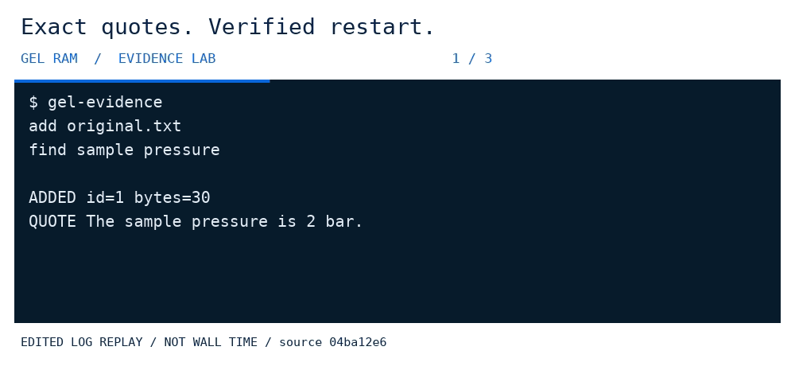</picture></a><p>Add a source, inspect its citation, save and reopen it in a separate process.</p><p><a href="media/gifs/01-evidence.txt">Transcript</a> · <a href="media/gifs/01-evidence-dark.gif">Dark full size</a></p></td>
<td width="50%" valign="top"><picture><source media="(prefers-color-scheme: dark)" srcset="media/presentation/chips/02-dark.svg"></picture><h4>Changed source. Old citation refused.</h4><a href="media/gifs/02-stale-light.gif"><picture><source media="(prefers-reduced-motion: reduce) and (prefers-color-scheme: dark)" srcset="media/gifs/02-stale-dark.png"><source media="(prefers-reduced-motion: reduce)" srcset="media/gifs/02-stale-light.png"><source media="(prefers-color-scheme: dark)" srcset="media/gifs/02-stale-dark.gif">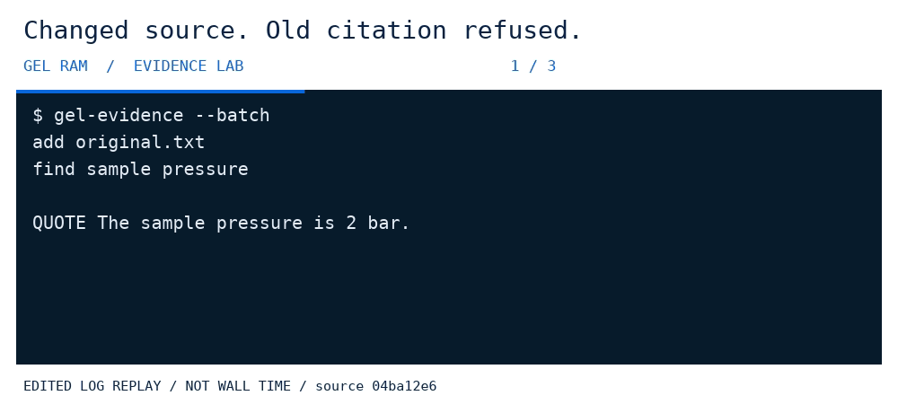</picture></a><p>Replace the source and inspect the refusal of the previous result.</p><p><a href="media/gifs/02-stale.txt">Transcript</a> · <a href="media/gifs/02-stale-dark.gif">Dark full size</a></p></td>
</tr>
<tr>
<td width="50%" valign="top"><picture><source media="(prefers-color-scheme: dark)" srcset="media/presentation/chips/03-dark.svg"></picture><h4>Backup. Inspect. Restore.</h4><a href="media/gifs/03-backup-light.gif"><picture><source media="(prefers-reduced-motion: reduce) and (prefers-color-scheme: dark)" srcset="media/gifs/03-backup-dark.png"><source media="(prefers-reduced-motion: reduce)" srcset="media/gifs/03-backup-light.png"><source media="(prefers-color-scheme: dark)" srcset="media/gifs/03-backup-dark.gif">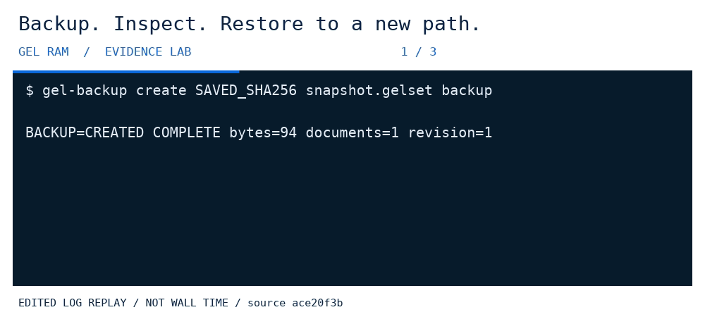</picture></a><p>Restore into a new path and check equality with the saved snapshot.</p><p><a href="media/gifs/03-backup.txt">Transcript</a> · <a href="media/gifs/03-backup-dark.gif">Dark full size</a></p></td>
<td width="50%" valign="top"><picture><source media="(prefers-color-scheme: dark)" srcset="media/presentation/chips/04-dark.svg"></picture><h4>One command. Inspect every result.</h4><a href="media/gifs/04-reproduce-light.gif"><picture><source media="(prefers-reduced-motion: reduce) and (prefers-color-scheme: dark)" srcset="media/gifs/04-reproduce-dark.png"><source media="(prefers-reduced-motion: reduce)" srcset="media/gifs/04-reproduce-light.png"><source media="(prefers-color-scheme: dark)" srcset="media/gifs/04-reproduce-dark.gif">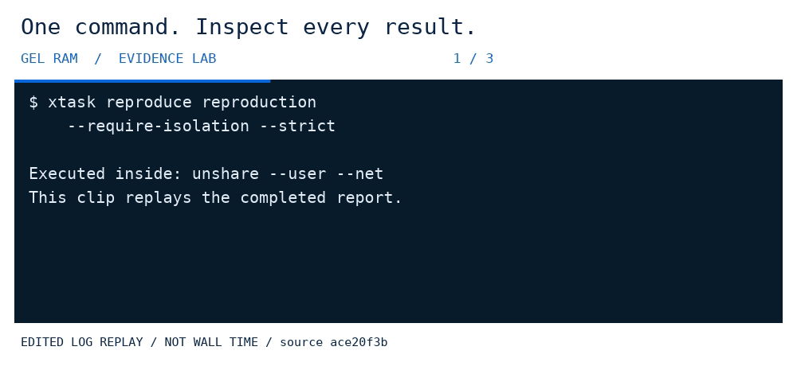</picture></a><p>Read the recorded strict reproduction result and its declared scope.</p><p><a href="media/gifs/04-reproduce.txt">Transcript</a> · <a href="media/gifs/04-reproduce-dark.gif">Dark full size</a></p></td>
</tr>
<tr>
<td width="50%" valign="top"><picture><source media="(prefers-color-scheme: dark)" srcset="media/presentation/chips/05-dark.svg"></picture><h4>Changed bytes. Retained pin. Refusal.</h4><a href="media/gifs/05-integrity-light.gif"><picture><source media="(prefers-reduced-motion: reduce) and (prefers-color-scheme: dark)" srcset="media/gifs/05-integrity-dark.png"><source media="(prefers-reduced-motion: reduce)" srcset="media/gifs/05-integrity-light.png"><source media="(prefers-color-scheme: dark)" srcset="media/gifs/05-integrity-dark.gif">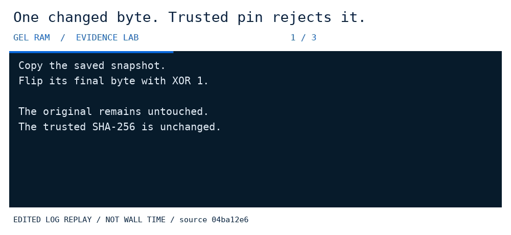</picture></a><p>A changed-byte copy is rejected against the original trusted hash.</p><p><a href="media/gifs/05-integrity.txt">Transcript</a> · <a href="media/gifs/05-integrity-dark.gif">Dark full size</a></p></td>
<td width="50%" valign="top"><picture><source media="(prefers-color-scheme: dark)" srcset="media/presentation/chips/06-dark.svg"></picture><h4>Your bytes. One record. Four views back.</h4><a href="media/gifs/07-literal-light.gif"><picture><source media="(prefers-reduced-motion: reduce) and (prefers-color-scheme: dark)" srcset="media/gifs/07-literal-dark.png"><source media="(prefers-reduced-motion: reduce)" srcset="media/gifs/07-literal-light.png"><source media="(prefers-color-scheme: dark)" srcset="media/gifs/07-literal-dark.gif">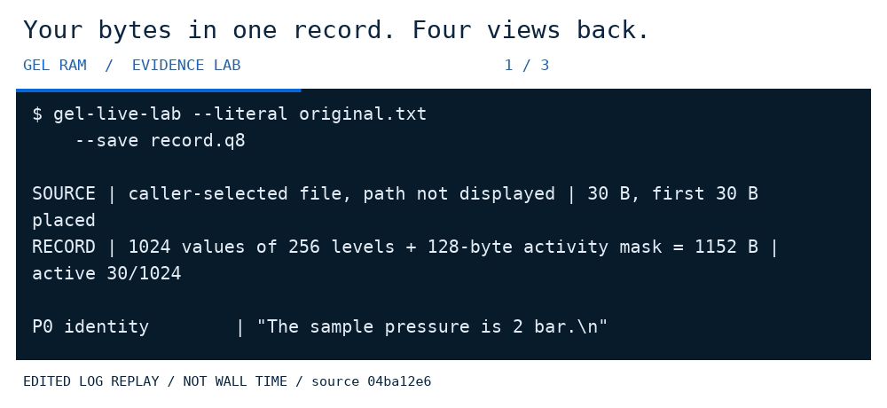</picture></a><p>Place a file's first bytes in one record, restore its four views and reject a changed byte.</p><p><a href="media/gifs/07-literal.txt">Transcript</a> · <a href="media/gifs/07-literal-dark.gif">Dark full size</a></p></td>
</tr>
</table>

## The memory core

| Part | What it does | Check it |
|:---|:---|:---|
| Bit record (`gel-orb`) | One fixed 128-byte record of 1,024 bits, 64-byte aligned; its bytes round-trip exactly | `exact_byte_roundtrip` · [format](docs/FORMAT.md) |
| Store (`gel-store`) | `.gel` v2 files carry a CRC64 over the header and over the payload; in the tests every single header bit flip, every payload byte flip and every truncation is rejected, and so is an older or equal save counter | `every_payload_byte_flip_is_rejected` · `generation_rollback_and_equal_generation_are_rejected` |
| Reader (`gel-reader`) | One comparison of two records returns 16 judgments at once, not 16 independent measurements; a search that stops early returns exactly the same top-K matches as a full scan | `progressive_top_k_is_exactly_equal_to_full_top_k` · [Reader16](docs/READER16.md) |
| Rebuild (`gel-structural`) | With its stored parent record, the XOR of the differing bits gives back the exact record; a missing parent or an invalid depth is refused, a wrong parent is not detected | `exact_xor_roundtrip_is_bit_identical` · [contract](docs/STRUCTURAL-CODEC.md) |
| History (`gel-history`) | Each state of one record is stored as a copy or as the XOR difference from the state before, at most two differences from a copy, and is rebuilt bit for bit | `long_history_is_exact_and_residual_depth_never_exceeds_two` · [contract](docs/RECORD-HISTORY.md) |
| Q8 record (`gel-phase-quad`) | One 1,152-byte record read through four equivalent views, each score equal to the reference bit for bit | `storage_is_1152_bytes_and_every_bit_survives` · [contract](docs/Q8-QUAD.md) |
| Memory cost (`gel-physics`) | Pointer-chase latency and read bandwidth of your own RAM from 48 KiB to 256 MiB; nanoseconds and GiB/s only, compared within one machine | `cargo run --locked --offline --release -p gel-physics -- 5` · [method](docs/PERFORMANCE.md) |

`cargo test --locked --offline -p CRATE` runs the tests named here; `cargo run --locked --offline --release -p gel-cli -- selftest` checks the first four parts in one run (`GEL_SELFTEST_V2=PASS`).

## Documentation

| Start and use | Inspect and reproduce | Project |
|:---|:---|:---|
| [Project map](docs/START-HERE.md) | [Claim registry](docs/CLAIMS.md) | [Roadmap](docs/ROADMAP.md) |
| [Evidence Lab](docs/EVIDENCE-LAB.md) · [batch mode](docs/EVIDENCE-BATCH.md) | [Reproduction guide](docs/REPRODUCE.md) | [Release notes v0.8.0](RELEASE-NOTES-v0.8.0.md) |
| [Backup and restore](docs/BACKUP.md) | [Per-platform CI evidence](docs/CI-EVIDENCE.md) | [Publication status](CANDIDATE-STATUS.md) |
| [Your bytes in one record](docs/LIVE-LAB.md) | [Mutation matrix](docs/MUTATION-MATRIX.md) · [crash series](docs/CRASH-SERIES.md) | [Measured progress](docs/MEASURED-PROGRESS.md) |
| [License decision guide](docs/LICENSE-DECISION.md) | [External checks](docs/EXTERNAL-CHECKS.md) | [All media and their scope](media/INDEX.md) |

The [full-page edition](README-MULTIMEDIA.html) opens from your checkout in a browser; GitHub shows HTML files as source ([presentation guide](docs/README-PRESENTATION.md)).

## About

<picture><source media="(prefers-reduced-motion: reduce) and (prefers-color-scheme: dark)" srcset="media/presentation/logo-still-dark.svg"><source media="(prefers-reduced-motion: reduce)" srcset="media/presentation/logo-still-light.svg"><source media="(prefers-color-scheme: dark)" srcset="media/presentation/logo-dark.svg"></picture>

GEL RAM is an independent hobby and research project by **RR — GEL RAM Project**, developed with AI assistance; this repository is not the complete private research system.
Third-party material keeps its own terms: the Rust Book fixture (MIT), the Unicode data files and the tables derived from them (Unicode License v3) and the quoted Wikipedia passages (CC BY-SA 4.0) ([third-party notices](THIRD-PARTY-NOTICES.md)).
[Contributing](CONTRIBUTING.md) · [Security reporting](SECURITY.md) · [CLA privacy](CLA-PRIVACY.md) · [Media rights](media/RIGHTS.md)
